<p align="center">
  
</p>

<h1 align="center">Snapora</h1>

<p align="center">
  <a href="https://apps.microsoft.com/detail/XPFP1M2H9VCJPD"></a>
</p>

<p align="center">Screenshot, annotation and pin-to-screen tool for Windows. Capture, annotate, organize. Everything stays on your machine.</p>

<p align="center"><b>English</b> | <a href="README.zh-CN.md">简体中文</a></p>

> This repository only distributes the Windows installer and release notes for Snapora. The source code is not published here.

## Screenshots

### Capture and recording

**Region selection and annotation toolbar**

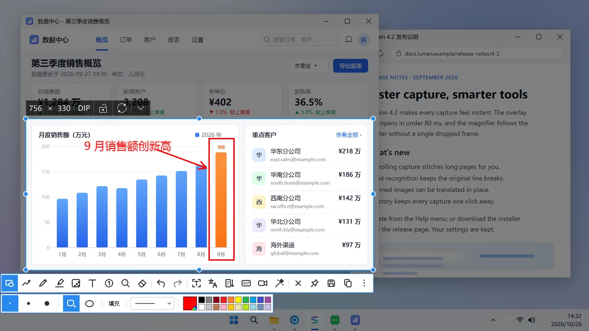

**Pixel magnifier and color picker**

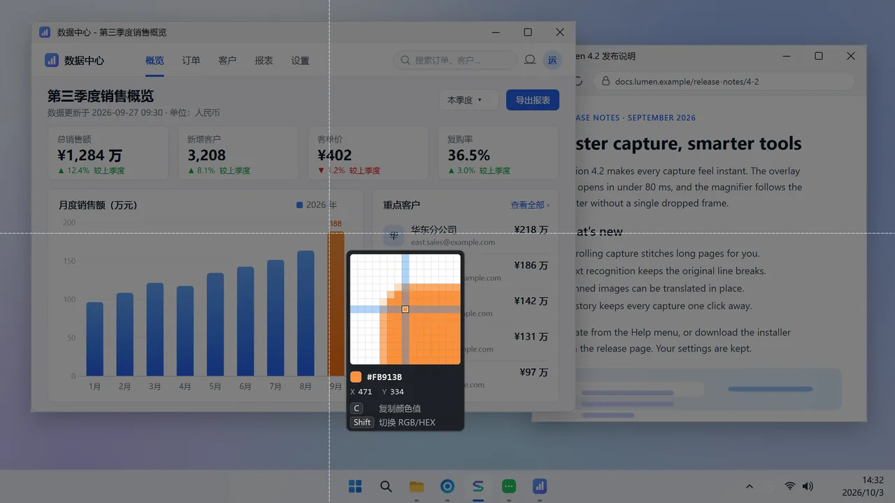

**Live preview while scrolling**

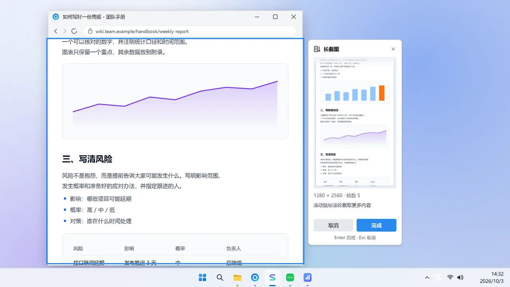

**The finished scrolling screenshot**

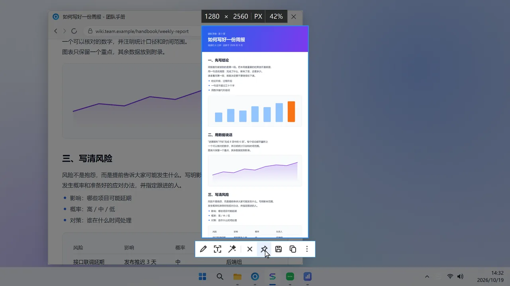

**GIF recording controls**

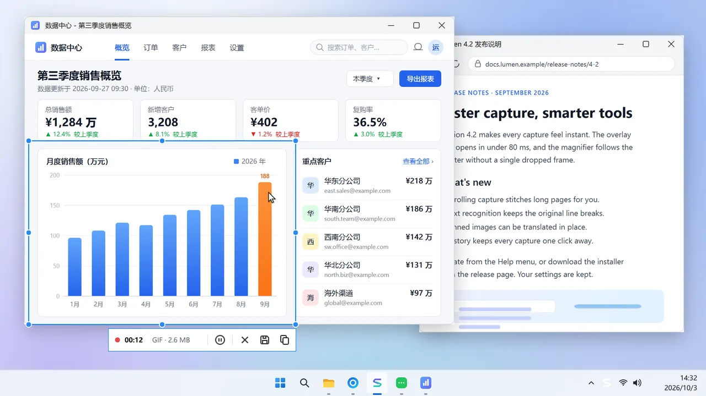

### Editing and pinning

**Annotating a chart in the editor**

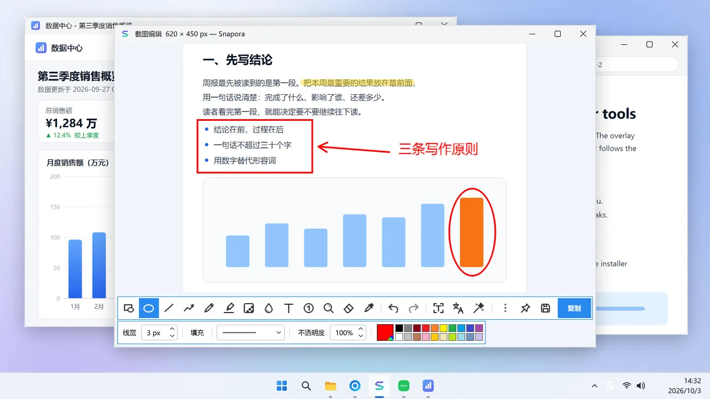

**Gradient background, rounded corners and shadow**

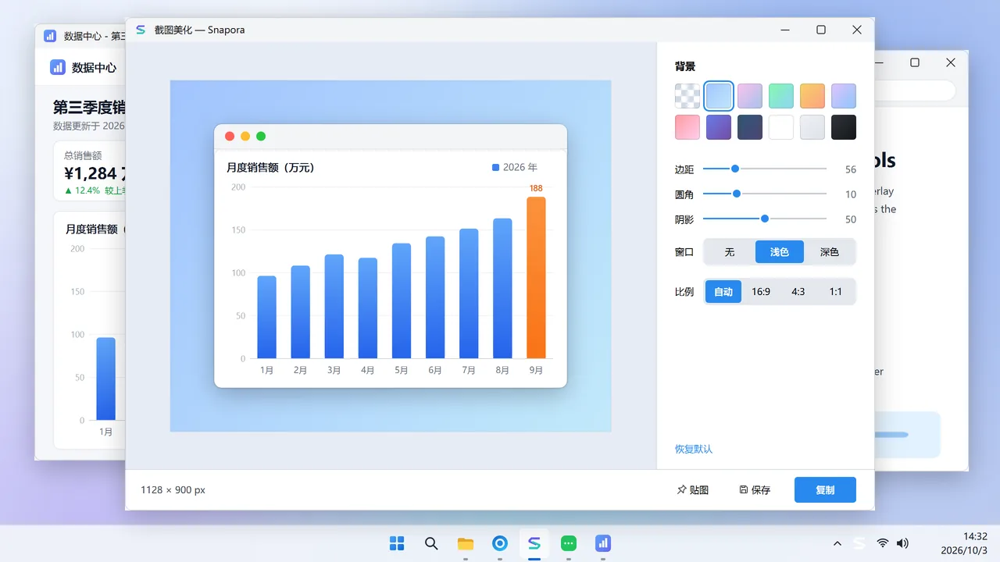

**Pinned windows and their context menu**

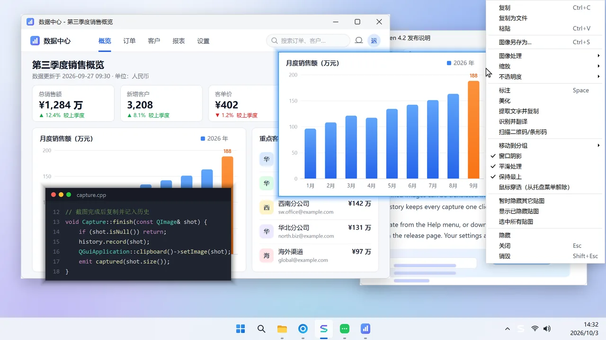

**Browsing recent captures**

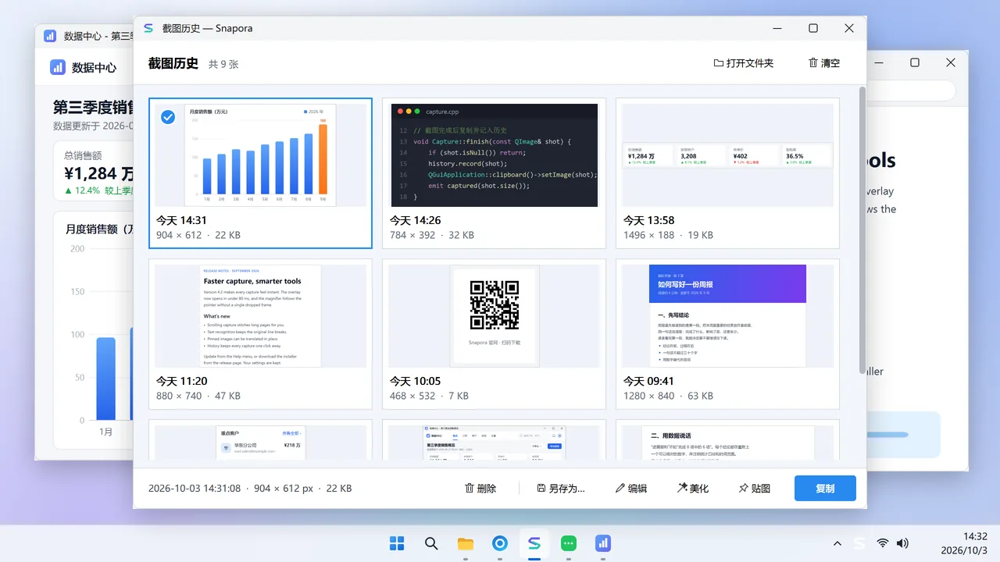

### Text and codes

**Editable OCR results**

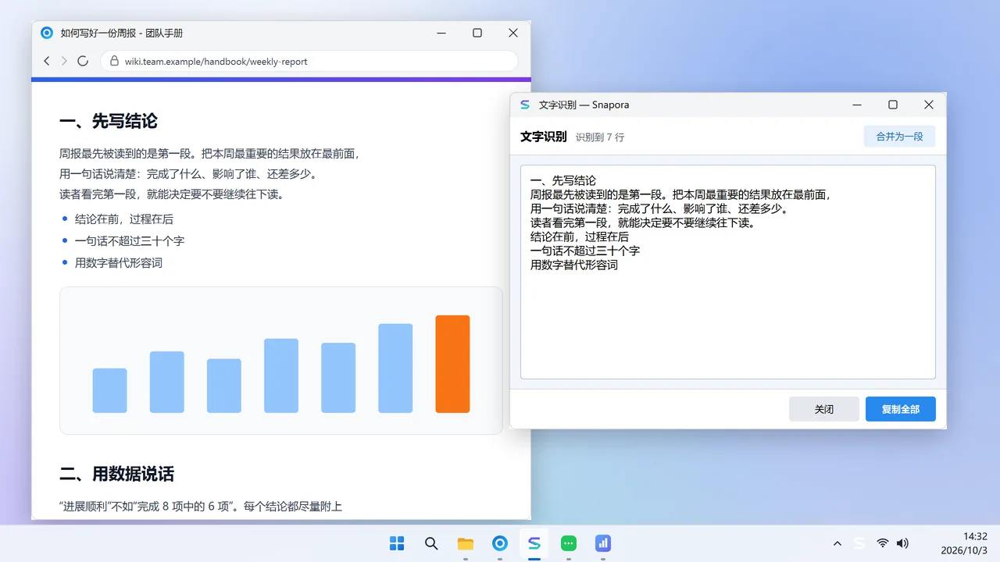

**Translated text in its original position**

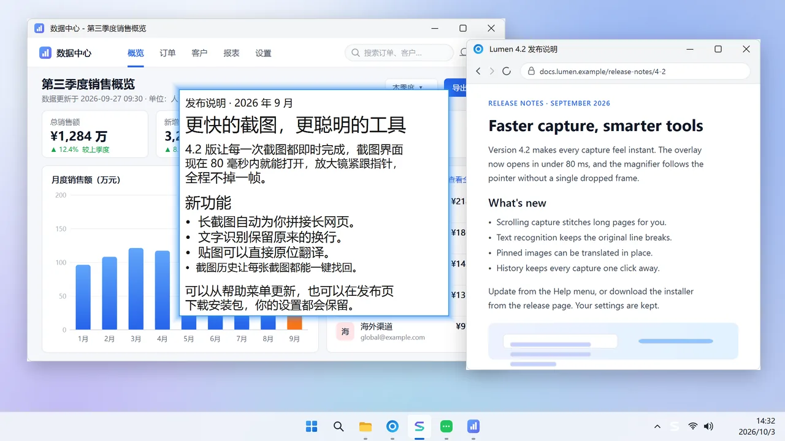

**Reading a QR code from a selection**

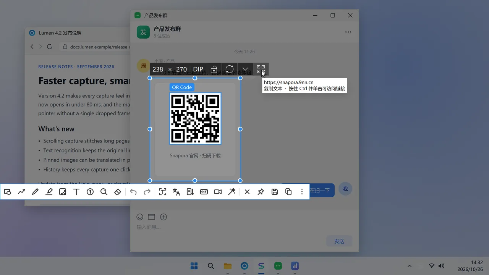

### Preferences and updates

**Setting up the drag-to-pin shortcut**

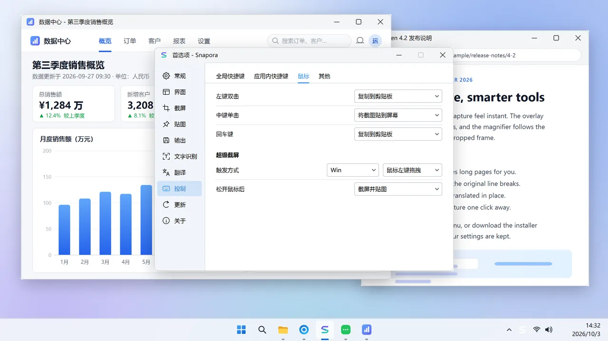

**Capture preferences**

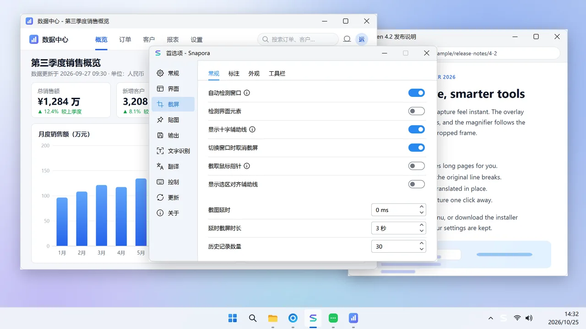

**Update prompt and download progress**

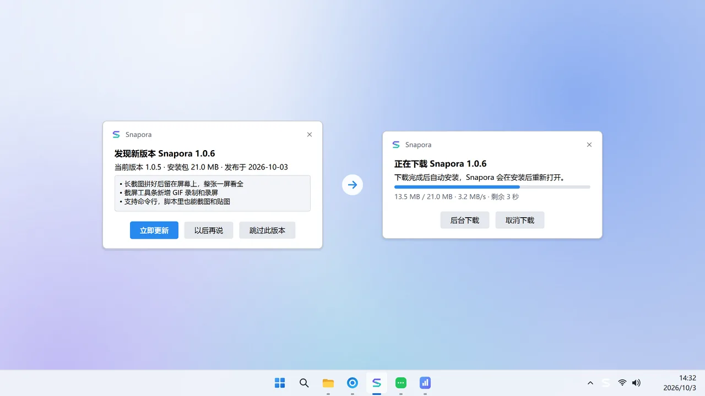

## Download and install

1. Open [Releases](https://github.com/Moresyl/Snapora/releases/latest) and download `Snapora-<version>-Setup.exe`.
2. A `.sha256` file with the same name sits next to every installer. Verify the download in PowerShell:

   ```powershell
   Get-FileHash .\Snapora-1.0.0-Setup.exe -Algorithm SHA256
   ```

   The printed hash must match the value in the `.sha256` file. Do not install if it differs.
3. Run the installer. It needs administrator rights, installs to `C:\Program Files\Snapora` by default, and can be removed from the Windows "Apps" page.

## System requirements

- Windows 10 or Windows 11, 64-bit
- No account is needed, and the core features work without an internet connection
- The user interface is currently in Simplified Chinese

## Features

**Screenshot**

- Press `F1` to start capturing; the hotkey can be changed in Preferences
- Region selection on the desktop, delayed capture, capture history with a configurable size
- Copy the result to the clipboard, save it to a file, or pin it straight to the screen

**Annotation**

- Pen, line, rectangle, ellipse, arrow, text, mosaic and blur
- Adjustable color and line width, undo and redo
- Text annotations can be re-opened for editing at any time and dragged around

**Pin to screen**

- Press `F3` to pin the image, text, HTML or image file from the clipboard to the screen
- Press `Shift+F3` to hide or show all pinned images
- Rotate, flip, zoom and change opacity; closed images can be restored, and groups and sessions are saved

**Preferences**

- Hotkeys, theme, capture history size, capture delay
- Update check, with "check for updates at startup" switchable off

## Privacy

- Screenshots, pinned images, clipboard history, settings and logs are stored only on your machine by default.
- The current version never uploads screenshots, clipboard content, settings or logs.
- The client contacts `snapora.9nn.cn` only when checking for updates, and you decide whether to download a new version.
- The full notice is in [LICENSE.txt](LICENSE.txt). It is the same Privacy Notice and Terms of Use that the installer shows.

## Feedback

- Bugs and suggestions: [GitHub Issues](https://github.com/Moresyl/Snapora/issues)
- Email: hi@9nn.cn
- Blog: https://blog.biekanle.com/

## Third-party components

Snapora is built with Qt and other open-source components. Their licenses are listed in [THIRD_PARTY_NOTICES.md](THIRD_PARTY_NOTICES.md).

## Copyright

© 2026 Mores. All rights reserved.
